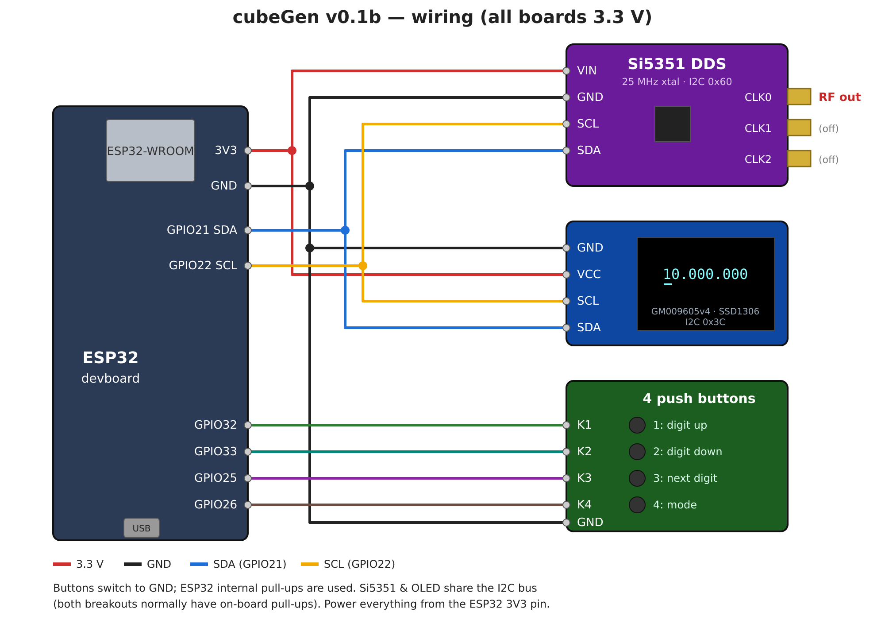

# cubeGen v0.1b

Simple RF signal generator: ESP32 + Si5351 + 0.96" OLED + 4 push buttons.

## Wiring (all 3.3 V)

| ESP32   | Si5351 | OLED (GM009605v4) | Buttons |
|---------|--------|-------------------|---------|
| 3V3     | VIN    | VCC               |         |
| GND     | GND    | GND               | GND     |
| GPIO21  | SDA    | SDA               |         |
| GPIO22  | SCL    | SCL               |         |
| GPIO32  |        |                   | K1      |
| GPIO33  |        |                   | K2      |
| GPIO25  |        |                   | K3      |
| GPIO26  |        |                   | K4      |

RF output: Si5351 **CLK0** SMA connector.

## Operation

The display shows the frequency in Hz as `10.000.000` (10 MHz at start-up),
with a cursor below the selected digit.

| Button | Function |
|--------|----------|
| 1 | Increase selected digit (carries over: 19 → 20). Hold to repeat. |
| 2 | Decrease selected digit (borrows: 20 → 19). Hold to repeat. |
| 3 | Select next digit to the right; wraps from last to first. |
| 4 | Select next mode (see below). |

The bottom line of the display shows `Mode: ` and the active mode.

| Mode | Output on CLK0 |
|------|----------------|
| `CW` | Continuous carrier |
| `CW-keyed` | Keyed carrier `-.-.-.` … (100 ms dot, 300 ms dash, 12 WPM) |
| `FSK470` | Alternates 500 ms on f and 500 ms on f + 470 Hz |
| `FSK850` | Same, with 850 Hz shift |
| `FSK1K` | Same, with 1 kHz shift |
| `FSK10K` | Same, with 10 kHz shift |
| `OFF` (default) | No output |

After `OFF` the mode wraps back to `CW`. The frequency can still be changed in every mode.

Range: 8 kHz … 99.999.999 Hz. Steps that would leave the range are ignored.

## Build & upload

Open the `cubegen` folder in VS Code with the PlatformIO extension, then
**Build** and **Upload** (environment `esp32dev`). Libraries are fetched
automatically.

## Calibration

Set `XTAL_CORRECTION` in `src/main.cpp` (parts per billion) to correct the
25 MHz crystal error.
