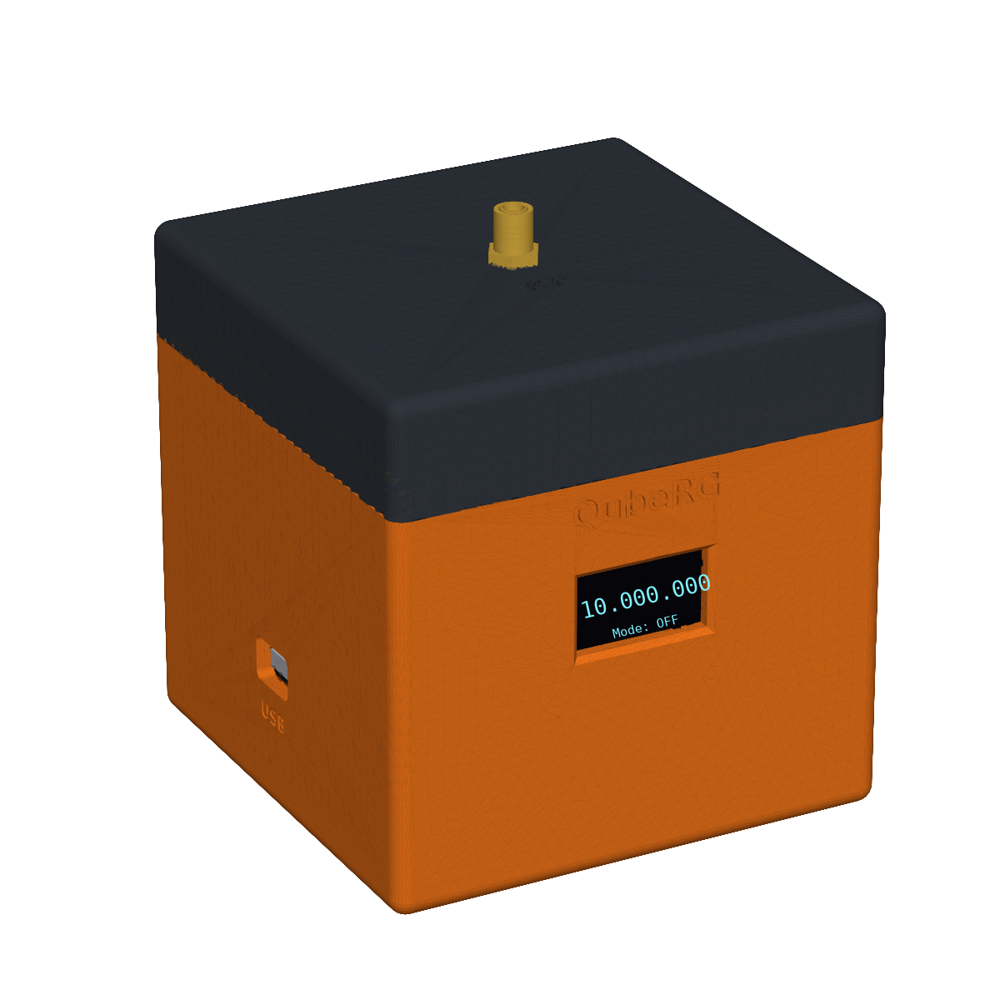
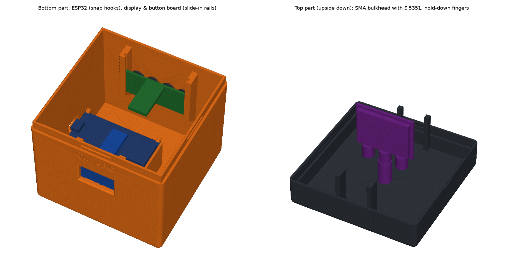

# QubeRG v0.1b

Simple RF signal generator: ESP32 + Si5351 + 0.96" OLED + 4 push buttons,
in a 3D-printed 90 mm cube with the RF output (SMA) on top.




## Wiring (all 3.3 V)

| ESP32   | Si5351 | OLED (GM009605v4) | Buttons |
|---------|--------|-------------------|---------|
| 3V3     | VIN    | VCC               |         |
| GND     | GND    | GND               | GND     |
| GPIO21  | SDA    | SDA               |         |
| GPIO22  | SCL    | SCL               |         |
| GPIO32  |        |                   | K1      |
| GPIO33  |        |                   | K2      |
| GPIO25  |        |                   | K3      |
| GPIO26  |        |                   | K4      |

RF output: Si5351 **CLK0** SMA connector.

## Operation

The display shows the frequency in Hz as `10.000.000` (10 MHz at start-up),
with a cursor below the selected digit.

| Button | Function |
|--------|----------|
| 1 | Increase selected digit (carries over: 19 → 20). Hold to repeat. |
| 2 | Decrease selected digit (borrows: 20 → 19). Hold to repeat. |
| 3 | Select next digit to the right; wraps from last to first. |
| 4 | Select next mode (see below). |

The bottom line of the display shows `Mode: ` and the active mode.

| Mode | Output on CLK0 |
|------|----------------|
| `CW` | Continuous carrier |
| `CW-keyed` | Keyed carrier `-.-.-.` … (100 ms dot, 300 ms dash, 12 WPM) |
| `FSK470` | Alternates 500 ms on f and 500 ms on f + 470 Hz |
| `FSK850` | Same, with 850 Hz shift |
| `FSK1K` | Same, with 1 kHz shift |
| `FSK10K` | Same, with 10 kHz shift |
| `OFF` (default) | No output |

After `OFF` the mode wraps back to `CW`. The frequency can still be changed in every mode.

Range: 8 kHz … 99.999.999 Hz. Steps that would leave the range are ignored.

## Case

The `case/` folder holds a 3D-printable cube case (FDM, PETG):

| File | Part | Print orientation |
|------|------|-------------------|
| `case/stl/qube_bottom.stl` | Floor + 4 walls (display window, USB hole, button holes) | As is, floor on the bed |
| `case/stl/qube_top.stl` | Lid with SMA hole and hold-down fingers | As is (already upside down) |
| `case/stl/qube_buttons.stl` | 4 button caps | As is, flange on the bed |



- **Two halves that click together:** the bottom part has a tongue with snap ridges, the top part slides over it. Use the notch on the right side to pry it open.
- **ESP32:** lies on the bottom, component side up, header pins pointing down (room for dupont plugs). It clicks between 4 flexible hooks; the USB connector lines up with the hole in the left wall.
- **Display:** slides into rails on the inside of the front wall, glass against the window.
- **Button board:** switches facing the back wall, slides into rails on the back wall. Put the 4 caps in the holes from the inside first.
- **Locking:** fingers on the lid press the display and button board down when the cube is closed.
- **Buttons marked** ▲ ▼ D M (up, down, Digit, Mode) on the back.
- **Si5351:** hangs from the lid, parallel to the front wall, right above the ESP32. Mount the SMA F-F bulkhead in the centre hole of the top, screw the M-M adaptor into it and the Si5351 CLK0 jack onto the adaptor.

Suggested print settings: PETG, 0.2 mm layers, 3 walls, 20 % infill, no supports.

**Measure your boards before printing.** Board sizes differ between suppliers. All dimensions are parameters at the top of `case/qube_case.py`. After changing them, regenerate the STLs and run the fit check against dummy boards:

```bash
pip install manifold3d numpy matplotlib
cd case && python3 qube_case.py --check --preview
```

## Build & upload

Open the `QubeRG` folder in VS Code with the PlatformIO extension, then
**Build** and **Upload** (environment `esp32dev`). Libraries are fetched
automatically.

## Calibration

Set `XTAL_CORRECTION` in `src/main.cpp` (parts per billion) to correct the
25 MHz crystal error.

## License

(c) 2026 PA3HCM

This work is licensed under the
[Creative Commons Attribution-NonCommercial 4.0 International License](https://creativecommons.org/licenses/by-nc/4.0/)
(CC BY-NC 4.0). You may share and adapt it for non-commercial purposes,
provided you give appropriate credit. See [LICENSE](LICENSE) for the full text.
